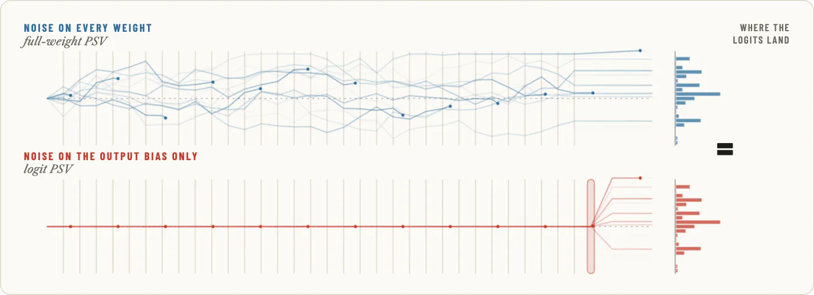
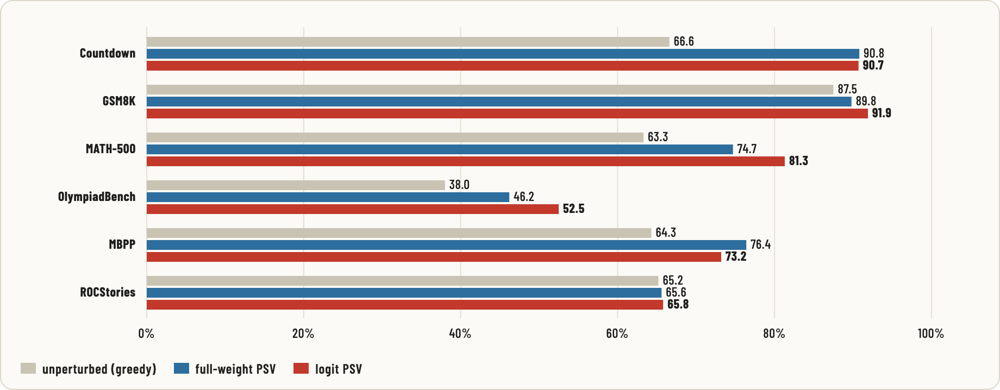
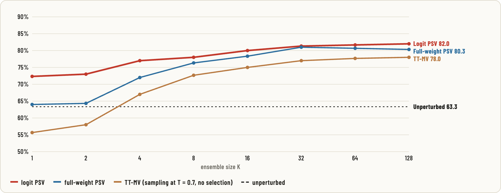

<div align="center">

# Rethinking Neural Thickets Without Weight Perturbations

[Nicolas Dufour](https://nicolas-dufour.github.io/)<sup>1</sup>,
[Elouan Gardès](https://scholar.google.com/citations?user=tJD-JnkAAAAJ)<sup>2,3</sup>,
[Amil Dravid](https://avdravid.github.io/)<sup>4</sup>,
[Patrick Pérez](https://ptrckprz.github.io/)<sup>5*</sup>,
[Loic Landrieu](https://loiclandrieu.com/)<sup>3</sup>

<sup>1</sup>Kyutai · <sup>2</sup>Meta FAIR ·
<sup>3</sup>LIGM, CNRS, Univ Gustave Eiffel, ENPC, Institut Polytechnique de Paris ·
<sup>4</sup>UC Berkeley · <sup>5</sup>Google DeepMind<br>
<sup>*</sup>Work done while at Kyutai.

[](https://arxiv.org/abs/2610.40649)
[](https://kyutai.org/logit-psv)

</div>

<picture>
  <source media="(prefers-color-scheme: dark)" srcset="assets/teaser-dark.webp">
  
</picture>

*Schematic. Each pair of lines is one perturbation drawn twice with the same final logit
shift. Top, full-weight PSV: the shift builds up over the 32 decoder blocks. Bottom, logit
PSV: it is added at the output bias.*

This repository is the official code for the language-model **logit Perturb-Select-Vote
(logit PSV)** results of the paper.

Logit PSV adapts a frozen language model without touching its weights:

1. **Perturb.** Member *i* draws one Gaussian bias over the vocabulary,
   `b_i = sigma * eps_i` with `eps_i ~ N(0, I_V)`. It adds `b_i` to the model's logits
   at every decoding step and for every input, then decodes greedily.
2. **Select.** Each of the *N* members is scored by its mean reward on 200 selection
   (train) items, and the top *K* are kept.
3. **Vote.** On each test item, the *K* members' extracted answers are majority-voted.

A member is fully determined by `(seed, sigma)`, so nothing per member is ever stored.
Its bias is regenerated from the seed whenever it is needed.

## Contents

| Path | What it is |
|---|---|
| [`logit_psv/tasks.py`](logit_psv/tasks.py) | The seven benchmarks: data, prompts, answer extraction, reward, check |
| [`logit_psv/psv.py`](logit_psv/psv.py) | The population, the selection, and the vote (no GPU code) |
| [`logit_psv/engine.py`](logit_psv/engine.py) | vLLM greedy generation and the logit-bias hook |
| [`logit_psv/run.py`](logit_psv/run.py) | CLI: resumable sample → ensemble → vote, one engine per GPU |
| [`reproduce/`](reproduce) | The paper's 27 cells, their numbers, a Slurm launcher, a report |
| [`docs/tasks.md`](docs/tasks.md) | Data, prompts and scoring of every task |
| [`tests/`](tests) | Fast CPU unit tests |

## Installation

You need Linux, Python 3.12, and an NVIDIA GPU whose driver supports CUDA 12.8.
[`uv`](https://docs.astral.sh/uv/) resolves the CUDA-specific wheels.

```bash
uv venv --python 3.12 .venv
# The exact environment of the paper's runs (vLLM 0.19.0, torch 2.10.0+cu128):
uv pip sync --python .venv/bin/python --torch-backend cu128 requirements.lock
# or, with looser pins:
# uv pip install --python .venv/bin/python --torch-backend cu128 -r requirements.txt
```

Datasets and models download from the Hugging Face Hub on first use. Countdown data is
fetched from a pinned GitHub commit and checked against its SHA-256. Set
`LOGIT_PSV_DATA` to store it somewhere other than `data/`.

## Quick start

One small run takes about 6 minutes on one H100, model loading included (Qwen2.5-0.5B,
32 members, GSM8K):

```bash
.venv/bin/python -m logit_psv.run \
  --model Qwen/Qwen2.5-0.5B-Instruct --task gsm8k \
  --population 32 --sigmas 0.5 --top-k 1,4,16 --test-samples 200
```

It prints the base accuracy and the vote accuracy for each K. Everything goes to a run
directory under `runs/`:

```text
config.json             configuration, SHA-256 of the items and rendered prompts, versions
base.json               base model: train reward, test accuracy, test answers
scores/*.jsonl          one row per member: idx, seed, sigma, train_reward
answers/rankRRRR.json   test answers of the member ranked R (0 = best)
results.json            accuracy for each K, and the selected members
logs/                   per-GPU worker logs (runs on several GPUs)
```

Every phase resumes where it stopped. Running the same command again after a crash or
a walltime limit continues the run. Pointing a different configuration at an existing
run directory is refused.

### Options

| Option | Meaning |
|---|---|
| `--task` | `countdown`, `gsm8k`, `math500`, `olympiadbench`, `mbpp`, `rocstories`, `uspto`; see [docs/tasks.md](docs/tasks.md) |
| `--population N` | Number of members (1000 in the paper) |
| `--sigmas 0.5[,1.0,...]` | Logit-bias scale; with several values, each member draws one uniformly |
| `--top-k 1,2,...,50` | Ensemble sizes to report; the top `max(K)` members are generated on test |
| `--train-samples`, `--test-samples` | Selection items (200) and test items (default: all) |
| `--max-tokens` | Generation limit (default: the task's, as in the paper) |
| `--seed` | Population seed (42 in the paper) |
| `--gpus` | GPUs to use (default: all visible); one vLLM engine per GPU |
| `--phase {sample,ensemble,vote}` | Run only some phases (repeatable) |

With several GPUs, each phase runs one single-GPU worker per GPU on a disjoint
contiguous slice of the members. A member's output does not depend on the slicing.
`CUDA_VISIBLE_DEVICES` must list GPU indices, not UUIDs, because vLLM requires indices.

## Reproducing the paper

Every logit-PSV number in the paper comes from one of 27 cells, one per model and
task, defined in [`reproduce/cells.py`](reproduce/cells.py). Each cell scores N = 1000
members with its model's σ (0.5 for Qwen2.5-0.5B, 1.0 for Qwen2.5-1.5B and 3B, 2.0 for
OLMo-3-7B), selects on 200 items with seed 42, and votes with the top K. Together they
give the logit-PSV column of the main-text and cross-scale tables and the logit-PSV
curves of the K-sweep figures. [`reproduce/expected.json`](reproduce/expected.json)
holds each cell's base and K-curve as reported.

```bash
# One cell, on the GPUs of the current machine:
.venv/bin/python -m reproduce.run Qwen2.5-0.5B-Instruct/gsm8k
# Several cells; a pattern matches ids containing all its comma-separated parts:
.venv/bin/python -m reproduce.run "0.5B" "Olmo-3-7B-Instruct/gsm8k"

# Everything, as whole-node (8-GPU) Slurm jobs: dry run first, then submit.
.venv/bin/python -m reproduce.submit --sbatch="--partition=<yours>"
.venv/bin/python -m reproduce.submit --sbatch="--partition=<yours>" --submit

# Tables and comparison with the paper's numbers (exit status 1 on any mismatch):
.venv/bin/python -m reproduce.report
```

Runs go to `runs/<model>/<task>`. A Slurm job that hits its walltime is submitted again
with the same command and resumes. All 27 cells take about 140 H100 GPU-hours, almost
all of it scoring members; with its packing margin, `reproduce.submit` plans 4 jobs
and about 29 node-hours.

### Expected results

Accuracy (%) of the greedy base → logit PSV at K = 50. Each base is measured on the
same test items as its logit-PSV run.

| task | Qwen2.5-0.5B | Qwen2.5-1.5B | Qwen2.5-3B | OLMo-3-7B |
|---|---:|---:|---:|---:|
| Countdown | 0.3 → **12.4** | 12.5 → **37.5** | 13.7 → **57.0** | 66.6 → **90.7** |
| GSM8K | 44.3 → **56.6** | 60.4 → **82.0** | 81.0 → **88.7** | 87.5 → **91.9** |
| MATH-500 | 29.0 → **40.7** | 48.3 → **60.0** | 62.7 → **71.7** | 63.3 → **81.3** |
| OlympiadBench | 9.5 → **16.7** | 21.5 → **28.7** | 31.6 → **40.5** | 38.0 → **52.5** |
| MBPP | 27.0 → **26.4** | 50.0 → **49.1** | 59.8 → **63.1** | 64.3 → **73.2** |
| ROCStories | 31.8 → **31.9** | 47.4 → **48.2** | 54.5 → **55.3** | 65.2 → **65.8** |
| USPTO | | 6.3 → **31.3** | 7.0 → **15.6** | 28.6 → **42.7** |

- **Qwen2.5-0.5B.** Its Countdown cell appears only in the K-sweep figure (its base
  model solves 0.3% of the puzzles), and the paper has no USPTO result for it.
- **USPTO.** A constant predictor of the majority reaction class scores 31.9%.
- **ROCStories.** The score is a lenient one (0.6 × position + 0.4 × adjacency), not
  exact-order accuracy. The cells score the first 1000 test stories, except
  Qwen2.5-3B, which is scored on all 97,961.

<picture>
  <source media="(prefers-color-scheme: dark)" srcset="assets/results-dark.png">
  
</picture>

*Accuracy (%) of OLMo-3-7B-Instruct at K = 50, with N = 1000 members for every method
(N = 2000 for full-weight PSV on Countdown). This repository reproduces the logit-PSV bars; the
full-weight PSV numbers are from the paper.*

<picture>
  <source media="(prefers-color-scheme: dark)" srcset="assets/ksweep-dark.png">
  
</picture>

*Accuracy (%) of OLMo-3-7B-Instruct on MATH-500 against the number K of voting members. The logit-PSV
curve is the `Olmo-3-7B-Instruct/math500` cell. Full-weight PSV and TT-MV (sampling the
unperturbed model at T = 0.7 and voting, without selection) are from the paper.*

## Implementation notes

These details determine the outputs exactly.

- **The bias.** `eps = torch.randn(V, generator=g, device="cuda", dtype=float32)` with
  `g` seeded by the member's seed, where `V` is the width of vLLM's logits (the padded
  vocabulary). It is added in **fp32**, `logits.float() + sigma * eps`. vLLM produces
  bf16 logits; adding in bf16 would round small biases onto the logits' bf16 grid. The
  bias is drawn once per member and reused at every step and for every prompt.
- **The population.** `numpy.random.default_rng(seed)`: `choice(2**31, N, replace=False)`
  for the seeds, then `choice(sigmas, N)` for the scales.
- **Selection and vote.** Members are ranked by train reward; ties go to the lower
  population index. The vote ignores abstentions (unparsable answers). A tie goes to
  the answer that the best-ranked member gave first. ROCStories votes count their
  fractional lenient score.
- **Generation.** vLLM in bf16, eager mode, no prefix caching, greedy (`temperature=0`),
  one `generate` call over all prompts, `gpu_memory_utilization=0.8`. These settings
  fix the batching, and through it the numerics.
- **Scorers.** The scorers are those of the paper, including their lenient parts:
  unanchored keyword patterns and a permissive matcher for MATH-500 and OlympiadBench,
  and a GSM8K train reward that also accepts the last number. See
  [docs/tasks.md](docs/tasks.md).

## Reproducibility

With the locked environment on H100 GPUs, the runs give the paper's numbers. Greedy
decoding is deterministic for a fixed GPU type, vLLM version and batch layout; another
GPU type or kernel version can flip near-tied tokens, and with them individual member
outputs, so the results then agree statistically rather than exactly.

MBPP adds one source of variation: generated programs run under a 10-second CPU limit,
so a program that runs close to it can pass on one machine and fail on another. A few
MBPP members can then differ by one selection problem, which can swap a member of the
top K and move a point of the K-curve by a fraction of a point. `reproduce.report`
compares exactly by default; `--tolerance 0.005` allows half a point.

## Tests

The unit tests run on CPU in about 15 seconds: the scorers, the logit-bias hook, the
population, selection, voting, and the pipeline with a stand-in engine (resume,
sharding, configuration checks).

```bash
make test     # python -m unittest discover -s tests
make lint     # ruff
```

They need neither vLLM nor a GPU. A light environment is enough:

```bash
uv venv --python 3.12 .venv-dev
uv pip install --python .venv-dev/bin/python --torch-backend cpu -r requirements-dev.txt
PYTHON=.venv-dev/bin/python RUFF=.venv-dev/bin/ruff make test lint
```

## Safety and limitations

- **MBPP executes generated Python.** Each candidate runs in a separate interpreter
  with CPU, memory and wall-time limits. That is not a security sandbox: run MBPP only
  on machines where you accept running untrusted code.
- A member decodes its own trajectory, so the cost is N greedy passes over the
  selection set plus K passes over the test set.
